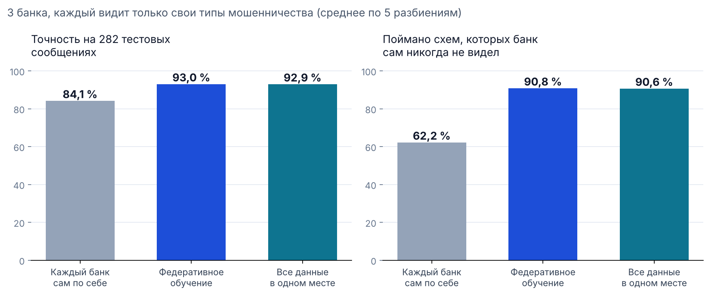

# Федеративное обучение: могут ли банки учить одну модель, не передавая друг другу сообщения клиентов

Числа получены скриптом `python scripts/eval_federated.py` (около 2,5 минуты). Все значения лежат в `results.json`, график — `chart.png`.

## Зачем

В октябре 2025 года ForteBank предложил банкам Казахстана общую антифрод-модель на федеративном обучении. Идея в том, что каждый банк учит модель у себя, а в общую систему уходит результат обучения, но не данные клиентов. Мы проверили эту идею на нашей задаче: распознавании мошеннических сообщений.

## Как устроена симуляция

- **Три условных банка.** Обучающие сообщения (без 282 тестовых сообщений жюри) делятся между тремя банками. Тест — те же 282 сообщения жюри; ни один банк на них не учится.
- **Два сценария:**
  - *все банки видят все типы мошенничества*: шаблоны разданы случайно;
  - *каждый банк видит только свои типы мошенничества*: каждому банку достаётся треть из 12 семейств схем (банк/карта, доставка, инвестиции и т. д.), обычные сообщения разданы случайно. Этот сценарий ближе к жизни: в разные банки приходят разные схемы.
- **Модель** — наша самая сильная одиночная модель, символьные n-граммы с логистической регрессией (её же использует Android-приложение).
  - Признаки строятся хешированием (HashingVectorizer). Ему не нужен общий словарь, поэтому банкам не приходится раскрывать свои слова.
  - Обучение — обычный градиентный спуск, записанный формулой: **w ← w − η · ( Xᵀ(σ(Xw + b) − y) / n + λw )**.
- **Три системы** с одной и той же моделью и одинаковым числом шагов (1 200):
  - **каждый банк сам по себе** — три отдельные модели, в таблице среднее по ним;
  - **федеративное обучение (FedAvg)**: в каждом из 120 раундов банк начинает с общих весов, делает 10 шагов на своих данных и отправляет только веса. Сервер усредняет их с учётом числа сообщений у каждого банка;
  - **все данные в одном месте** — так было бы, если бы банки передали друг другу сообщения. Это верхняя граница.
- Каждый сценарий повторён на 5 случайных разбиениях данных между банками.

## Результаты

**Каждый банк видит только свои типы мошенничества** (среднее по 5 разбиениям):

| | Точность (282 сообщения) | Поймано мошенничества | Поймано схем, которых банк сам не видел | Ложные тревоги из 152 |
|---|---|---|---|---|
| Каждый банк сам по себе | 84,1 % | 71,9 % | **62,2 %** | 8,2 |
| **Федеративное обучение** | **93,0 %** | **90,9 %** | **90,8 %** | 8,0 |
| Все данные в одном месте | 92,9 % | 90,8 % | 90,6 % | 8,0 |

**Все банки видят все типы мошенничества:**

| | Точность | Поймано мошенничества |
|---|---|---|
| Каждый банк сам по себе | 88,6 % | 82,5 % |
| Федеративное обучение | 92,9 % | 90,8 % |
| Все данные в одном месте | 92,9 % | 90,8 % |

**Главный вывод.** Федеративная модель работает так же, как модель на объединённых данных: разница в пределах 0,1 п.п. При этом ни одно сообщение не покидает свой банк. Сильнее всего выигрывают схемы, которых банк сам ещё не видел: в одиночку банк ловит 62 % таких сообщений, вместе с другими — 91 %. Это и есть смысл отраслевой модели: мошенническая схема, обнаруженная в одном банке, начинает ловиться во всех.

**Что передаётся.** Каждый банк за раунд отправляет 262 145 чисел — веса модели. Тексты сообщений не передаются никогда.

## Ограничения

1. **Это симуляция, а не три настоящих банка.** Данные — наш набор, искусственно разделённый между «банками».
2. **Модель упрощена.** Хеширование вместо TF-IDF и только символьная модель вместо всего ансамбля. Централизованная версия даёт 92,9 % против 93,6 % у той же модели в scikit-learn.
3. **Шаг обучения выбран так, чтобы централизованная модель сошлась.** Значения одинаковы для всех трёх систем.
4. **Веса модели всё же несут информацию о данных.** Для настоящего внедрения нужны защищённое усреднение (secure aggregation) и дифференциальная приватность. Это следующий шаг, мы его не делали.
