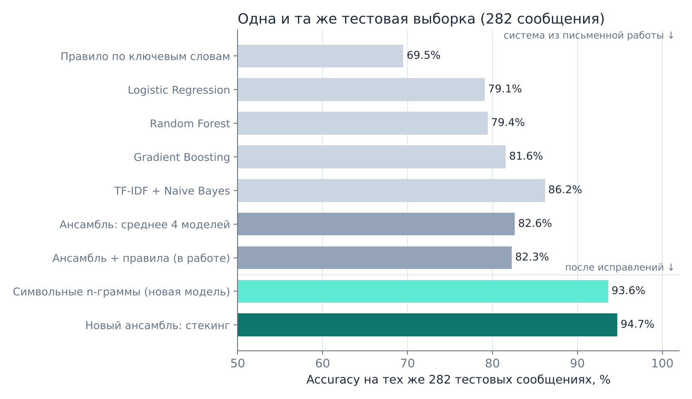
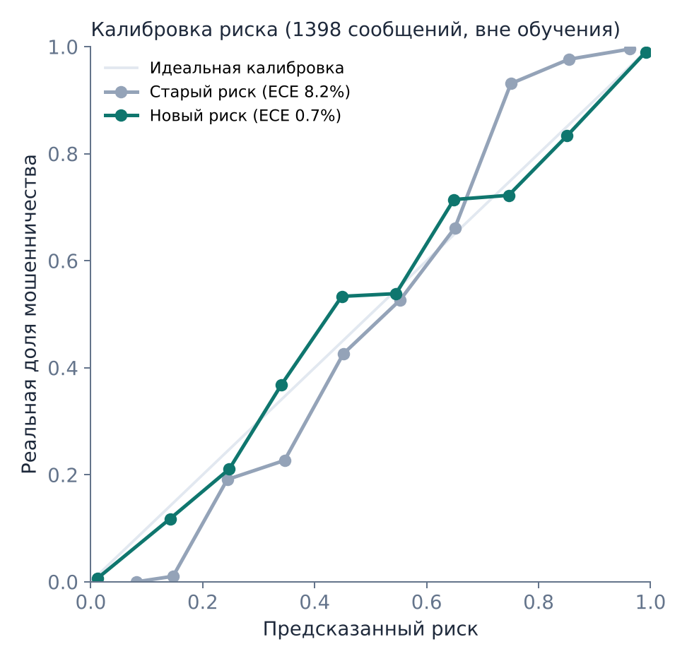
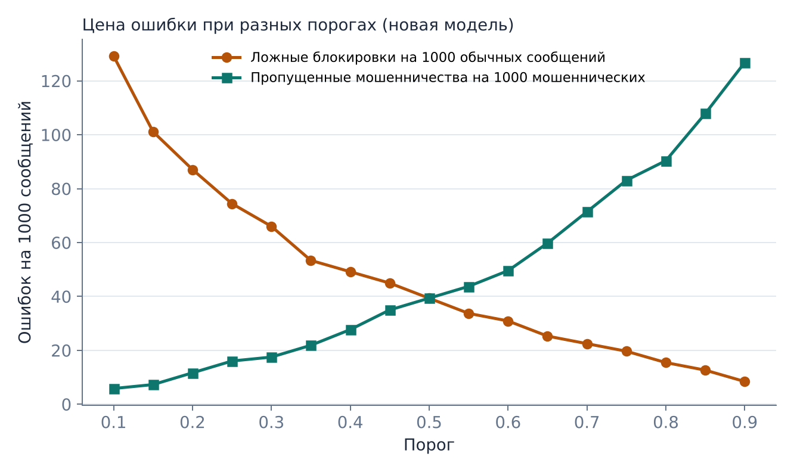

# AI Fraud Detector: ответы на замечания жюри

**Ордалин Нұрасыл, Ғани Ақжол** · проект 21, «Математика и прикладная математика»
Замечания из оценки письменных проектов НИШ Тараз от 09.10.2026.

Все числа ниже получены скриптом `python scripts/run_jury_evaluation.py`, полный прогон занимает около 4 минут.
Таблицы лежат в CSV-файлах этой папки, все значения собраны в `results.json`.

---

## Коротко

| | Система из работы | После исправлений |
|---|---|---|
| Accuracy на тех же 282 тестовых сообщениях | 82,3 % (TN 130, FP 22, FN 28, TP 102) | **94,7 %** (TN 146, FP 6, FN 9, TP 121) |
| Accuracy, среднее по 15 разбиениям (3 × 5 групповых фолдов) | 85,5 % ± 1,8 | **96,1 % ± 1,4** |
| Ложные блокировки на реальных обычных SMS (2 242 сообщения) | 18,2 % | **0,3 %** |
| Казахский язык, accuracy | 73,6 % | **88,4 %** |
| Новые типы мошенничества, которых не было в обучении (доля пойманных) | 76,0 % | **84,1 %** |
| Калибровка риска (ECE, меньше лучше) | 8,2 % | **0,7 %** |

## Ключевой вопрос: какой выигрыш даёт ансамбль над лучшей одиночной моделью на тех же 282 сообщениях

**Честный ответ про систему из работы: выигрыша не было.**
На тех же 282 сообщениях одна модель TF-IDF + Naive Bayes дала 86,2 %, а ансамбль с правилами 82,3 %.
Причина в простом среднем: три модели на ключевых признаках (LR, RF, GB, около 80 % каждая) давали три голоса из четырёх и перевешивали сильную текстовую модель.
На одном тесте из 282 сообщений эта разница статистически незначима: тест Макнемара даёт p = 0,22, ансамбль прав там, где TF-IDF ошибся, в 28 случаях, а обратная ситуация встречается в 39.
Но она устойчива: на 15 разных разбиениях TF-IDF был лучше ансамбля **во всех 15** (в среднем 92,0 % против 85,5 %).

**Что исправлено.** Модели теперь объединяет не простое среднее, а **стекинг**: логистическая регрессия учится на прогнозах моделей, сделанных вне обучения (out-of-fold, с разбиением по шаблонам), и сама подбирает вес каждой модели.
Кроме того, добавлена пятая модель, **символьные n-граммы + логистическая регрессия**. Она видит части слов, поэтому узнаёт казахские и русские окончания (*картаңыз / карту / карта*) и искажённые написания (*k0d*).
Подобранные веса: символьные n-граммы 1,66, TF-IDF 1,39, GB 0,49, RF 0,22, правила 0,35, LR 0,08.

**Результат на тех же 282 сообщениях** (все модели после исправлений обучены на одинаковых данных):

| Система | TN | FP | FN | TP | Accuracy | Precision | Recall | F1 |
|---|---|---|---|---|---|---|---|---|
| Правило по ключевым словам (ориентир) | 141 | 11 | 75 | 55 | 69,5 % | 83,3 % | 42,3 % | 56,1 % |
| *Система из работы:* | | | | | | | | |
| Logistic Regression | 129 | 23 | 36 | 94 | 79,1 % | 80,3 % | 72,3 % | 76,1 % |
| Random Forest | 125 | 27 | 31 | 99 | 79,4 % | 78,6 % | 76,2 % | 77,3 % |
| Gradient Boosting | 124 | 28 | 24 | 106 | 81,6 % | 79,1 % | 81,5 % | 80,3 % |
| TF-IDF + Naive Bayes | 125 | 27 | 12 | 118 | **86,2 %** | 81,4 % | 90,8 % | 85,8 % |
| Ансамбль: среднее 4 моделей | 131 | 21 | 28 | 102 | 82,6 % | 82,9 % | 78,5 % | 80,6 % |
| Ансамбль + правила (как в работе) | 130 | 22 | 28 | 102 | 82,3 % | 82,3 % | 78,5 % | 80,3 % |
| *После исправлений:* | | | | | | | | |
| TF-IDF + Naive Bayes | 140 | 12 | 23 | 107 | 87,6 % | 89,9 % | 82,3 % | 85,9 % |
| Символьные n-граммы + LR (лучшая одиночная) | 143 | 9 | 9 | 121 | 93,6 % | 93,1 % | 93,1 % | 93,1 % |
| **Стекинг-ансамбль (итоговая система)** | **146** | **6** | **9** | **121** | **94,7 %** | **95,3 %** | **93,1 %** | **94,2 %** |

**Значимость** (точный тест Макнемара; 95 % доверительный интервал разницы accuracy получен кластерным бутстрепом по шаблонам):

| Сравнение на 282 сообщениях | Только A прав | Только B прав | p | Разница accuracy, 95 % ДИ |
|---|---|---|---|---|
| Новый ансамбль против старого ансамбля с правилами | 39 | 4 | < 0,001 | +12,4 п.п. [+7,7; +17,8] |
| Новый ансамбль против лучшей одиночной модели (символьные n-граммы) | 6 | 3 | 0,51 | +1,1 п.п. [−1,1; +3,3] |
| Старый ансамбль с правилами против TF-IDF из той же системы | 28 | 39 | 0,22 | −3,9 п.п. [−9,7; +1,9] |
| Старый ансамбль без правил против старого ансамбля с правилами | 1 | 0 | 1,00 | +0,4 п.п. |

**Устойчивость** проверена на 15 разбиениях: 3 повтора по 5 групповых фолдов, на всех 1 398 сообщениях.
Новый ансамбль в среднем точнее лучшей одиночной модели на 1,2 п.п. (96,1 % против 94,8 %) и выигрывает по F1 **в 12 из 15** разбиений.
Старую систему он превосходит **во всех 15** (+10,5 п.п.).
Главное преимущество ансамбля над символьной моделью не в accuracy, а в надёжности процента риска: Brier score 0,028 против 0,052 (см. пункт 3).

**Правила** почти ничего не меняют. Без правил и с правилами старый ансамбль расходится в 1 сообщении из 282.
В новом ансамбле правила остались одним из входов (вес 0,35, то есть не больше +0,1 к логиту). Их основная роль теперь в объяснении: они показывают пользователю, *почему* сообщение подозрительно.

### Готовый ответ на защите

**Русский.** В версии из письменной работы ансамбль не давал выигрыша над лучшей одиночной моделью: на тех же 282 сообщениях TF-IDF + Naive Bayes показал 86,2 %, а ансамбль с правилами 82,3 %. Простое среднее давало трём слабым моделям на ключевых словах больше голосов, чем сильной текстовой модели. Мы заменили среднее на стекинг, который сам учит вес каждой модели, и добавили модель на символьных n-граммах. Теперь на тех же 282 сообщениях точность 94,7 % против 93,6 % у лучшей одиночной модели. На одном тесте эта разница незначима (p = 0,51), но на 15 разбиениях ансамбль выигрывает в 12, а процент риска у него заметно точнее откалиброван (Brier 0,028 против 0,052).

**Қазақша.** Жазбаша жұмыстағы нұсқада ансамбль ең жақсы жалғыз модельден озған жоқ: дәл сол 282 хабарламада TF-IDF + Naive Bayes 86,2% дәлдік көрсетті, ал ережелері бар ансамбль 82,3% көрсетті. Себебі қарапайым орташалауда кілт сөздерге негізделген үш әлсіз модель күшті мәтіндік модельден көбірек дауыс алды. Біз орташалауды стекингпен алмастырдық, ол әр модельдің салмағын деректерден өзі үйренеді, сондай-ақ символдық n-грам моделін қостық. Енді сол 282 хабарламада дәлдік 94,7%, ал ең жақсы жалғыз модельде 93,6%. Бір тестте бұл айырма статистикалық маңызды емес (p = 0,51), бірақ 15 бөліністің 12-сінде ансамбль жеңеді, ал оның тәуекел пайызы әлдеқайда дұрыс калибрленген (Brier 0,028 және 0,052).

---

## Пункт 1. Лучшая одиночная модель, ансамбль и ансамбль с правилами на одном тесте

Выполнено, см. таблицу выше.
Тестовые 282 сообщения те же, что в работе: на коде из репозитория воспроизводятся ровно TN = 130, FP = 22, FN = 28, TP = 102.
Тест собран групповым разбиением: все варианты одного шаблона попадают только в одну часть.
Лучшая одиночная модель выбрана **без подглядывания в тест**, по F1 на обучающей выборке вне фолдов: символьные n-граммы 94,6 %, TF-IDF 90,3 %.
На тесте лучшей оказалась она же.

Отдельно исправлена ошибка, на которую указало жюри. Раньше в боковой панели приложения у каждой модели показывалась точность обычной перекрёстной проверки. Её завышают почти одинаковые шаблоны, и её нельзя сравнивать со строгим тестом ансамбля.
Теперь все модели и ансамбль проверяются на **одном и том же** групповом отложенном тесте, и панель подписывает это явно.

## Пункт 2. Реальные сообщения, отдельно по языкам и по новым типам мошенничества

### 2.1 Независимые реальные сообщения

Использован открытый корпус **UCI SMS Spam Collection**: 5 574 настоящих английских SMS, после удаления дубликатов 5 171.
Корпус разделён пополам по шаблонам. Из одной половины в обучение добавлены 400 сообщений (300 обычных и 100 спама). Вторая половина, **2 574 сообщения, ни разу не использовалась при обучении** и служит тестом.

| На 2 574 реальных SMS вне обучения | Система из работы | После исправлений |
|---|---|---|
| Ложно заблокированы обычные сообщения (из 2 242) | **407 (18,2 %)** | **7 (0,3 %)** |
| Помечено как подозрительное из спама (332) | 258 (77,7 %) | 299 (90,1 %) |
| ROC-AUC | 0,883 | 0,994 |

Это главная находка проверки. Модель, обученная только на написанных шаблонах, считала мошенническими почти каждое пятое обычное сообщение.
Например, «Realy sorry-i don't recognise this number… who r u please?!» получало 90 % риска.
Причина в том, что живые сообщения короче, неформальнее и с ошибками, а в шаблонах такого стиля не было. Именно об этом писало жюри.
Добавление 400 реальных сообщений почти полностью убрало проблему.

Оговорки:
- проверка только на английском языке, потому что открытых корпусов реальных казахских и русских SMS нет;
- класс «spam» в UCI включает и мошеннические рассылки (призы, платные номера), и обычную рекламу;
- 400 обучающих и 2 574 тестовых сообщения взяты из одного корпуса, но это разные сообщения, и похожие варианты одного текста не попадают в обе части.

Среди 7 оставшихся ложных срабатываний есть, например, «We have sent JD for Customer Service… For details contact us» (98 %) и «Realy sorry-i don't recognise this number…» (84 %).

**Казахские и русские реальные сообщения** команде нужно собрать самостоятельно: не меньше 50 на язык, примерно поровну мошеннических и обычных.
Инструкция и шаблон таблицы лежат в `data/real/README.md`. Проверка запускается одной командой:
`python scripts/run_jury_evaluation.py --real data/real/team_real_messages.csv`.
Результат будет отдельно по каждому языку, для старой и новой системы.

### 2.2 Отдельно по каждому языку

Оценки собраны со всех 1 398 сообщений: каждое оценено моделью, которая не видела ни его, ни вариантов его шаблона (групповая 5-кратная проверка).

| Язык | Сообщений (мошеннических) | Accuracy: работа → сейчас | Recall: работа → сейчас | Ложные тревоги: работа → сейчас |
|---|---|---|---|---|
| Казахский | 121 (62) | 73,6 % → **88,4 %** | 54,8 % → **85,5 %** | 6,8 % → 8,5 % |
| Русский | 672 (328) | 85,6 % → **96,4 %** | 86,3 % → **97,3 %** | 15,1 % → **4,4 %** |
| Английский | 605 (296) | 88,3 % → **97,2 %** | 90,5 % → **97,0 %** | 13,9 % → **2,6 %** |

Казахский остаётся самым слабым языком. В данных всего 121 казахское сообщение, это 9 % выборки.
Старая система пропускала почти половину казахских мошеннических сообщений, сейчас пропускает 15 %. При этом ложных тревог на казахском стало чуть больше: 5 вместо 4 из 59.
Главный способ улучшить казахский язык дальше — добавить реальные казахские сообщения.

### 2.3 Новые типы мошенничества

Проверка устроена так: из обучения полностью убирается один тип мошенничества вместе со всеми похожими шаблонами, а затем измеряется, какую долю сообщений этого **ни разу не виденного** типа система всё равно ловит.
Так проверено 12 типов.

| Тип мошенничества (не было в обучении) | Сообщений | Работа | Сейчас | Ориентир: правило по словам |
|---|---|---|---|---|
| Банк / карта / колл-центр банка | 114 | 81,6 % | **94,7 %** | 64,9 % |
| Инвестиции / крипта / работа | 104 | 63,5 % | 66,3 % | 26,0 % |
| Доставка / госорганы / родственник в беде | 90 | 81,1 % | **92,2 %** | 48,9 % |
| QR-коды / штрафы / платные дороги | 64 | 85,9 % | 89,1 % | 60,9 % |
| Романтические / знакомства | 53 | 30,2 % | 41,5 % | 11,3 % |
| Подделка брендов / подписки | 52 | 75,0 % | **84,6 %** | 38,5 % |
| Аккаунты / SIM / мессенджеры | 42 | 88,1 % | 88,1 % | 66,7 % |
| Долги / суды / коммуналка / благотворительность | 42 | 92,9 % | 95,2 % | 57,1 % |
| Техподдержка / устройство | 42 | 73,8 % | **90,5 %** | 45,2 % |
| Призы / налоги / наследство / лотереи | 39 | 84,6 % | **100 %** | 53,8 % |
| Аренда / маркетплейсы / покупки | 30 | 86,7 % | 83,3 % | 16,7 % |
| Бизнес-почта / счета / зарплата | 20 | 90,0 % | **100 %** | 55,0 % |
| **Всего (взвешенно)** | 692 | **76,0 %** | **84,1 %** | 45,9 % |

Самые трудные новые типы — **романтические** (ловится 41,5 %) и **инвестиционные** (66,3 %).
Такие сообщения сначала выглядят как обычная переписка, и признаки мошенничества (деньги, ссылка, срочность) появляются только позже.
Это стоит прямо назвать на защите как направление развития: анализ всей переписки, а не одного сообщения.

## Пункт 3. Калибровка риска и цена ложной блокировки

### 3.1 Калибровка

Калибровка проверена на всех 1 398 сообщениях, оценённых вне обучения.

| | Система из работы | После исправлений |
|---|---|---|
| Brier score (меньше лучше) | 0,104 | **0,029** |
| ECE, средний разрыв между «обещанным» и реальным риском | 8,2 % | **0,7 %** |

В старой системе процент нельзя было читать как вероятность.
Из сообщений с риском около 75 % мошенническими были 93 %, а из сообщений с риском около 15 % — только 1 %.
Новая система обучена с логистической функцией потерь, поэтому её выход и есть вероятность: при риске около 85 % мошенническими оказались 83 % сообщений.

### 3.2 Цена ложной блокировки при разных порогах

Ниже показаны результаты новой системы на 1 398 сообщениях вне обучения: 712 обычных и 686 мошеннических.

| Порог | Ложные блокировки на 1 000 обычных | Пропущено мошенничества на 100 | Precision |
|---|---|---|---|
| 0,15 | 101 | 0,7 | 90,4 % |
| 0,25 | 74 | 1,6 | 92,7 % |
| 0,50 | 39 | 3,9 | 95,9 % |
| 0,75 | 20 | 8,3 | 97,8 % |
| 0,80 | 15 | 9,0 | 98,3 % |

Полная таблица порогов от 0,10 до 0,90 лежит в `3_thresholds_final.csv`.

Цену пропущенного мошенничества примем за 1 и рассмотрим три режима:

| Режим | Цена ложной блокировки | Порог по теории (c / (c + 1)) | Лучший порог на данных | Ловит мошенничества | Ложных блокировок на 1 000 |
|---|---|---|---|---|---|
| Предупреждение (жёлтая плашка) | 0,2 | 0,17 | 0,15 | 99,3 % | 101 |
| Ошибки равноценны | 1 | 0,50 | 0,35 (при 0,50 цена почти та же: 55 против 53) | 97,8 % | 53 |
| Автоблокировка (сообщение скрыто) | 5 | 0,83 | 0,80 | 91,0 % | 15 |

Лучшие пороги на данных почти совпадают с формулой теории принятия решений. Это отдельное подтверждение калибровки: формула работает только тогда, когда риск действительно является вероятностью.
Для сравнения: старая система в режиме автоблокировки при своём лучшем пороге ловила всего 66 % мошенничества.
В приложении эти рекомендации добавлены в подсказку к ползунку порога: 0,15–0,25 для предупреждений и 0,75–0,8 для автоблокировки.

---

## Что изменено в коде

- `fraud_model.py` (новый файл): пять моделей и стекинг, все гиперпараметры, групповое разбиение по шаблонам, загрузка реальных сообщений. Один и тот же код используют приложение, проверка и тесты.
- `app.py`: обучение через `fraud_model.py`, пять моделей на графике согласия, отчёт и JSON с новой моделью, боковая панель с честными метриками на одном тесте.
- `translations.py`: обновлены тексты на трёх языках (5 моделей, калиброванный риск, рекомендации по порогу).
- `fraud_eval.py`, `scripts/run_jury_evaluation.py`: вся проверка из этого отчёта (тест Макнемара, кластерный бутстреп, калибровка, цена порогов, новые типы мошенничества).
- `data/external/`: корпус UCI, обучающая выборка из 400 сообщений и отложенная половина (`scripts/prepare_external_data.py`).
- `data/real/`: шаблон и инструкция для сбора казахских и русских сообщений.
- `tests/test_fraud_model.py`: 13 новых тестов, в том числе регрессионный тест «новый ансамбль лучше старого на тесте жюри». Проходят все 82 теста.

## Что остаётся ограничением

1. Реальные казахские и русские сообщения ещё не проверены: инструмент готов, данные нужно собрать.
2. Казахских сообщений мало (121), и казахский по-прежнему самый слабый язык.
3. Романтическое и инвестиционное мошенничество нового вида ловится плохо (41 % и 66 %).
4. Выигрыш нового ансамбля над лучшей одиночной моделью небольшой (+1,2 п.п.) и на одном тесте из 282 сообщений незначим.
5. ~~Браузерное расширение по-прежнему работает на упрощённой офлайн-логике.~~ Исправлено позже: расширение и Android-приложение используют ту же модель символьных n-грамм (проверена против scikit-learn с точностью до 10⁻⁶).

## Дополнительно после предзащиты

- **Устойчивость к маскировке** («к0д», латинские буквы вместо русских, «к о д ы», невидимые символы): на тесте жюри замаскированные мошеннические сообщения ловились в 46–83% случаев, после нормализации текста — в 93%, как без маскировки. На обычных сообщениях ничего не ухудшилось. Подробно: [`reports/obfuscation/REPORT_RU.md`](../obfuscation/REPORT_RU.md).
- **Кнопка «Это ошибка»** на сайте, в расширении и в приложении: отметки сохраняются в формате `data/real/` и превращаются в независимую проверку на реальных сообщениях (ответ на пункт 1 ограничений).
- **Исследование с людьми** (`docs/user_study/`): помогает ли система человеку, а не только модели. Листы, протокол и анализ готовы, данные собирает команда.
- **Проверенная и отклонённая идея:** оценивать несколько сообщений подряд вместе. Выигрыш на разбитых сообщениях есть, но растут ложные тревоги: [`reports/conversation_window/REPORT_RU.md`](../conversation_window/REPORT_RU.md).
