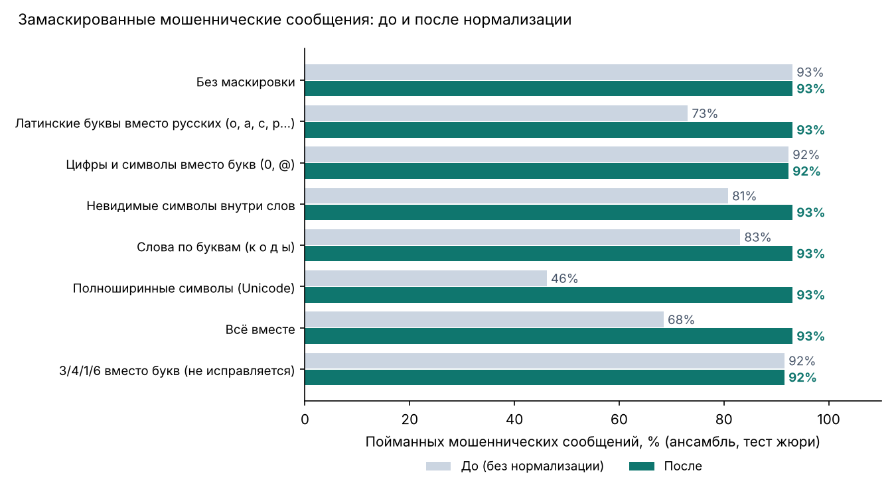

# Маскировка текста: насколько она мешала и что даёт нормализация

Мошенники пишут «к0д», «зaблoкирoвана» латинскими буквами, «к о д ы» по буквам или вставляют невидимые символы, чтобы фильтры не узнали слова. Мы проверили, как это действует на систему, и добавили шаг **нормализации текста** (`text_normalize.py`): перед проверкой маскировка снимается. Шаг одинаковый на сайте, в Android-приложении и в расширении.

**Как проверяли.** Тот же честный тест, что и для жюри: 282 сообщения, шаблоны не пересекаются с обучением. Каждое из 130 мошеннических сообщений теста замаскировали шестью способами (детерминированно, с фиксированным seed) и посчитали, сколько система всё равно поймала: без нормализации (как было) и с ней. Модели обучены заново в обоих вариантах на одних и тех же данных.

## Сколько мошеннических сообщений поймано

| Маскировка | Сайт: до | Сайт: после | Телефон/расширение: до | Телефон/расширение: после |
|---|---|---|---|---|
| Без маскировки | 93.1% | **93.1%** | 93.1% | **93.1%** |
| Латинские буквы вместо русских (o, a, c, p…) | 73.1% | **93.1%** | 76.9% | **93.1%** |
| Цифры и символы вместо букв (0, @) | 92.3% | **92.3%** | 88.5% | **93.8%** |
| Невидимые символы внутри слов | 80.8% | **93.1%** | 78.5% | **93.1%** |
| Слова по буквам (к о д ы) | 83.1% | **93.1%** | 82.3% | **93.1%** |
| Полноширинные символы (Unicode) | 46.2% | **93.1%** | 46.9% | **93.1%** |
| Всё вместе | 68.5% | **93.1%** | 65.4% | **92.3%** |
| 3/4/1/6 вместо букв (не исправляется) | 91.5% | **91.5%** | 87.7% | **87.7%** |

## Не стало ли хуже на обычных сообщениях

| | До | После |
|---|---|---|
| Точность на исходных 282 сообщениях (сайт) | 94.7% | 94.7% |
| Ложные тревоги на обычных сообщениях теста (сайт) | 3.9% | 3.9% |
| Ложные тревоги на 2242 реальных обычных SMS (сайт) | 0.4% | 0.4% |
| Ложные тревоги на реальных обычных SMS (телефон/расширение) | 1.1% | 1.1% |

## Что это значит и ограничения

- Маскировку проверяли на **наших же** сообщениях, замаскированных программой. Настоящие мошенники могут маскировать иначе; строка «3/4/1/6 вместо букв» специально оставлена неисправленной: замена цифр на буквы ломала бы настоящие суммы и коды, поэтому этот приём остаётся слабым местом.
- Нормализация не трогает ссылки: поддельный адрес «kаspi.kz» с русской «а» по-прежнему распознаётся как подделка.
- Перезапуск: `python scripts/eval_obfuscation.py` (около 0 мин).
